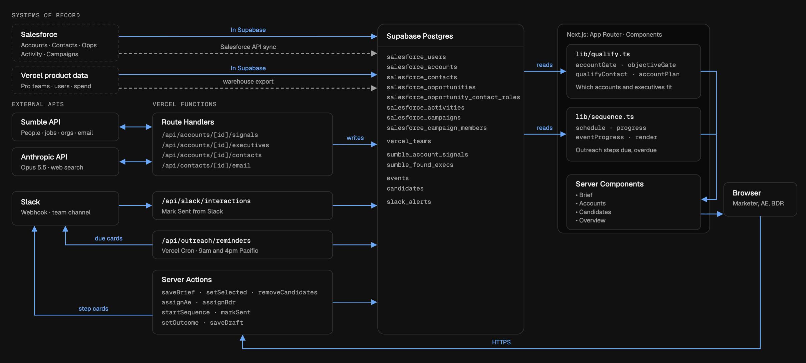

# Getting the Right People in the Room

This platform, Seatbook, helps fill executive seats at Vercel events (an F1 suite, a breakfast, a dinner). It takes an event from "Who should we invite for this event?" to "Who said yes?" in one place. 

## Problems it solves

Steps 3 & 4 are directly targeted at what's mentioned in the brief, on current BDR team manually finding contacts at target accounts and sequencing them in Outreach.

| Stage | Problem | What our build solves |
|---|---|---|
| 1. Pick Accounts | Hard to quickly identify which target accounts from Vercel's TAM suit this event. | **Event Brief** page allows Marketing to define here: target personas, seniority, candidate location criteria, ideal outreach sequence (i.e. AE- or BDR- lead, with specified follow-up days) etc.     **Accounts** filters Vercel's target accounts in Salesforce by event requirements and shows existing Vercel Pro usage. |
| 2. Gather Context across Account / Contacts | Context on all our contacts and interaction history is spread across Salesforce, billing data etc, so invite quality is consistent and/or end up generic. | Each **Account** page shows Vercel Pro usage, past account interaction (Salesforce), event attendance (Salesforce campaign) – along with new leadership changes, job posts and relevant AI initiatives in specified category for event. |
| **3. Identify the Right Executives** | Executives are scattered across the CRM with no view of who fits this event, and the right ones may be missing or have stale titles. | Under Account page, **Executives** consolidates executives across entire account with context on whether they align with this event, i.e. Qualified, Review or Excluded (e.g. matches persona, below seniority, outside location).     **Signals** `LEADERSHIP CHANGE` category identifies most recent leaders in target personas along with their LinkedIn profile URL.     **Find Executives** searches Sumble for that account's target personas, defined in Event Brief. ––> **Result**: List of real executives with LinkedIn profile URL that user can select to add to CRM and Executives list for that account. |
| **4. Sequence Outreach** | Follow-ups slip. Nobody knows who owns which step. | **Candidates** shows list of selected candidates for that event across all accounts, and allows assigning of AEs/BDRs. Outreach sequence shows each step with drafts and has live Slack integration via Slack webhook (currently configured to Rachel's personal Slack workspace `vercel-trial`). |
| 5. Track progress | No single view of how complete event preparation is. | **Overview** shows progress against the specified goals in Event Brief and a Kanban board tracking pipeline. |

## Sample Flow

Visa is a real target account. Its signals are cleared on purpose, so you can see them being generated.

1. **Brief.** Open the Las Vegas Grand Prix brief. Check the target verticals, personas, seniority, location and guest target. This event is **AE-led**, so no BDR is needed.
2. **Accounts.** Find the account row for Visa. Click **Open Plan**.
3. **Account plan: Signals.** Click either buttons. They can run at the same time, but will take a while till you can refresh.
   - Clicking **Refresh Sumble Signals** loads new leaders hired and recent job post summaries. You can 'Add to CRM' the executives you deem relevant.
   - Clicking **Research AI Initiatives** uses Claude to search the web for Visa's AI projects via three categories: Internal Software; Retail/Agentic Commerce; Financial Services.
4. **Account plan: Executives.**
   - Executives already in the CRM are checked against the brief, showing as **Qualified**, **Review** or **Excluded** with context.
   - Clicking **Find Executives** allows you to find more people (in the target personas for this event) within this account via Sumble's /people API endpoint. Click **Add to CRM** on any result to save into CRM and onto this account page.
   - Select **Add Candidate** on the people to indicate as candidates for this event.
5. **Candidates.**
   - The candidates you've selected across all accounts for this event appear here.
   - Clicking **Find Email** fetches a missing email for that candidate via Sumble if needed.
   - **Start Sequence** kickstarts the outreach sequence, which involves a message to the respective AE/BDR via Slack.
6. **Per Candidate Invitation** (click **Invitation Plan →**).
   - Outreach Sequence shows entire timeline with steps and draft each. You can edit, open in Gmail, or copy it.
   - The ideal outcome is to sync this with Outreach's API and generate an Outreach sequence per event that syncs with the respective AE/BDR's inbox.
   - Temporary setup: **Mark Sent** once it goes out. Candidate outcome can be updated via **Replied, Accepted or Declined**.
7. **Overview.** View overview of invitation pipeline with shortlisted, invited and accepted counts against the targets. The pipeline board shows each candidate's stage and owner.

## Architecture

## External API Integrations

| Button | Service | What it does | Endpoint / Webhook URL |
|---|---|---|---|
| Refresh Sumble Signals | Sumble | Leadership changes and hiring from job posts. | `api.sumble.com/v9/organizations`, `/v9/people`, `/v9/jobs` |
| Research AI Initiatives | Claude with web search, via Vercel AI Gateway | Up to 10 searches. Keeps one initiative per theme. | `ai-gateway.vercel.sh/v1/messages` |
| Find Executives | Sumble | People matching the brief's personas (about 100 credits). | `api.sumble.com/v9/organizations`, `/v9/people` |
| Add to CRM | Sumble | The person's current title and location (about 4 credits). | `api.sumble.com/v9/people` |
| Find Email | Sumble | Reveals a work email (10 credits). | `api.sumble.com/v9/people` |
| Start Sequence, Mark Sent, outcomes | Slack | Posts a card or alert to the team channel. | Incoming webhook: `hooks.slack.com/services/…` (set as `SLACK_WEBHOOK_URL`) Seatbook posts a message to the webhook, which drops it into the channel. Clicking **Mark Sent** in Slack calls back to Seatbook at `/api/slack/interactions`. |
| Send Reminders, plus a daily schedule | Slack | Reminds senders of steps due or overdue, at 9am and 4pm Pacific. | API route: `/api/outreach/reminders`, then the Slack webhook Vercel Cron calls the reminders route twice a day. It finds steps due or overdue and posts a card for each to the webhook. |

All Sumble calls are `POST`s with the API key. 

**Slack:** alerts post to `#<event-invitations>`, the channel the Slack webhook was set up for. Slack message has configured buttons **Mark Sent**, **Edit in Seatbook**, and **Open in Gmail**. In production, AE or BDR would be tagged in the message to that channel instead.

