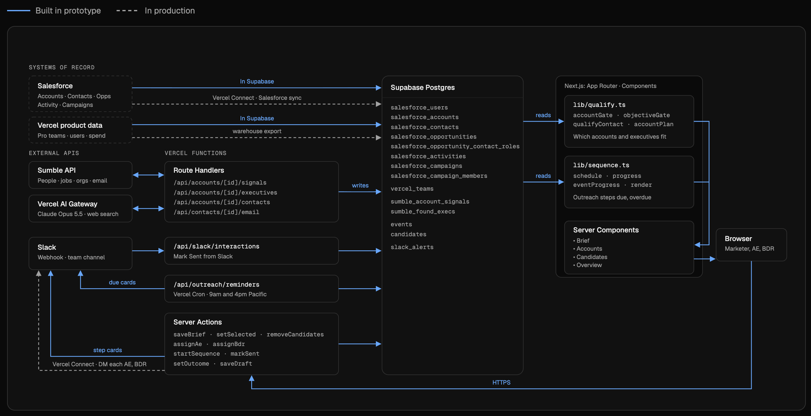

# Getting the Right People in the Room

This platform, Seatbook, helps fill executive seats at Vercel events (an F1 suite, a breakfast, a dinner). It takes an event from "Who should we invite for this event?" to "Who said yes?" in one place. Refer to [Sample Flow](#sample-flow) for typical flow.

## Problems it solves

Steps 3 & 4 are directly targeted at what's mentioned in the brief, on current BDR team manually finding contacts at target accounts and sequencing them in Outreach.

| Stage | Problem | What our build solves |
|---|---|---|
| 1. Pick Accounts | Hard to quickly identify which target accounts from Vercel's TAM suit this event. | **Event Brief** page allows Marketing to define here: target personas, seniority, candidate location criteria, ideal outreach sequence (i.e. AE- or BDR- lead, with specified follow-up days) etc. <br> <br> **Contacts** filters Vercel's target accounts in Salesforce by event requirements and shows existing Vercel Pro usage. |
| 2. Gather Context across Account / Contacts | Context on all our contacts and interaction history is spread across Salesforce, billing data etc, so invite quality is inconsistent and/or generic. | **Contacts** lists every contact at each fitting account, under a quiet account line with its tier, vertical, Vercel Pro usage and AE. Each contact shows **Prior Engagement**, one amber dot per kind: **Prior event attendance** or **Prior event invite** in the last year (Salesforce campaigns), **Prior email reply**, **Prior meeting** (Salesforce activity), and **On Vercel plan** when they're a team's billing owner. A green **No prior engagement** when none apply. |
| **3. Identify the Right Executives** | Executives are scattered across the CRM with no view of who fits this event, and the right ones may be missing or have stale titles. | On **Contacts**, each contact shows whether they fit this event, i.e. Qualified or Excluded, with why (e.g. matches seniority, below seniority, outside location). Filter by AE and engagement, or **Show Qualified Only**, tick executives and **Add Candidates**. <br> <br> **Find More Executives** searches Sumble for technical leaders new in their role in the last six months who pass the brief's seniority gate, then tops up to 5 with people in the account's target personas, defined in Event Brief. ––> **Result**: real executives with LinkedIn profile URL, each showing whether they match a target persona and whether they're **New in role**, to **Add to Contacts**. |
| **4. Sequence Outreach** | Follow-ups slip. Nobody knows who owns which step. | **Invites** shows list of selected candidates for that event across all accounts, and allows assigning of AEs/BDRs. Outreach sequence shows each step with drafts and has live Slack integration via Slack webhook (currently configured to Rachel's personal Slack workspace `vercel-trial`). |
| 5. Track progress | No single view of how complete event preparation is. | **Overview** shows progress against the specified goals in Event Brief and how many candidates are at each stage, each linking to its tab on **Invites**. |

## Who Uses It

- **Head of Marketing:** **All Events** shows overview of statistics and dates for all events, clicking on each event card also reveals **Overview** of each event.
- **Marketing:** Each event in the sidebar, in workflow order: **Brief**, **Contacts**, **Invites** with root page showing progress for that event.
- **AEs/BDRs:** **For AE/BDR** lists their steps due across every event, one row per candidate (with the draft and Open in Outreach), and replies to answer. Slack pings them about the same steps daily at 9am.

## Sample Flow

1. **Brief.** In the sidebar, open **Las Vegas GP**, then **Brief**. Check the target verticals, personas, seniority, location and guest target.
2. **Contacts.** Every contact at the accounts that fit the brief, grouped by account.
   - Each contact shows a dot per check from the brief, e.g. **Matches VP and above** (green when it passes; red with the reason when they're excluded), and their **Prior Engagement**.
   - Pick an AE or an engagement level from the dropdowns, or click **Show Qualified Only**. E.g. **Cold Contacts Only** with **Show Qualified Only** for net-new executives.
   - Click **Find More Executives** on an account (e.g. **Visa**) to search Sumble for technical leaders new in their role who pass this event's seniority gate, topped up to 5 with people in its target personas. It takes up to a minute. Results show under the account's contacts with whether they match a persona and when they started; **Add to Contacts** saves them to the CRM, where you can tick them as candidates.
   - Tick the executives to invite and click **Add Candidates**.
3. **Invites.** One tab per stage: **Pending Approval**, **Pending Push to Outreach**, **In Sequence**, **Replied**, **Accepted**, **Declined**.
   - **Pending Approval:** marketing clicks **Approve** (or **Approve Selected**) to give candidates their seats; the AE/BDR gets a Slack message that they're ready.
   - **Pending Push to Outreach:** the AE/BDR checks the copy, then **Push to Outreach** kickstarts the outreach sequence, with a Slack card to the sender. Clicking **Find Email** fetches a missing email via Sumble if needed.
4. **Invitation plan** (click **Invitation Plan →**).
   - Outreach Sequence shows entire timeline with steps and draft each. You can edit, open in Gmail, or copy it.
   - The ideal outcome is to sync this with Outreach's API and generate an Outreach sequence per event that syncs with the respective AE/BDR's inbox.
   - Temporary setup: **Mark Sent** once it goes out. Candidate outcome can be updated via **Replied, Accepted or Declined**.
5. **Overview.** Shortlisted, invited and accepted counts against the targets, how many candidates are at each stage (click one to open its tab on Invites), and Recent Activity lists the Slack alerts.
6. **For AE/BDR.** Pick who you're viewing as (an AE or BDR) to see their queue across all events.

## Architecture



## External API Integrations

| Button | Service | What it does | Endpoint / Webhook URL |
|---|---|---|---|
| Find More Executives | Sumble | Up to 7 technical leaders new in role who pass the seniority gate; while under 5, persona matches from the 30 most senior tech people fill in (about 50–125 credits). | `api.sumble.com/v9/organizations`, `/v9/people` |
| Add to Contacts | Sumble | The person's current title and location (about 4 credits). | `api.sumble.com/v9/people` |
| Find Email | Sumble | Reveals a work email (10 credits). | `api.sumble.com/v9/people` |
| Push to Outreach, Mark Sent, outcomes | Slack | Posts a card or alert to the team channel. | Incoming webhook: `hooks.slack.com/services/…` (set as `SLACK_WEBHOOK_URL`)<br>Seatbook posts a message to the webhook, which drops it into the channel. Clicking **Mark Sent** in Slack calls back to Seatbook at `/api/slack/interactions`. |
| Daily reminders (Vercel Cron) | Slack | Reminds senders of steps due or overdue, daily at 9am Pacific. | API route: `/api/outreach/reminders`, then the Slack webhook<br>Vercel Cron calls the reminders route once a day. It finds steps due or overdue and posts a card for each to the webhook. |

All Sumble calls are `POST`s with the API key. 

**Slack:** alerts post to `#<event-invitations>`, the channel the Slack webhook was set up for. Slack message has configured buttons **Mark Sent**, **Edit in Seatbook**, and **Open in Gmail**. In production, AE or BDR would be tagged in the message to that channel instead.

## Run the app locally

```bash
npm install
cp .env.example .env.local        # fill in the keys
npx supabase link --project-ref <project-ref>
npx supabase db push --include-seed   # create the tables and load the sample data
npm run dev                          # http://localhost:3000
```